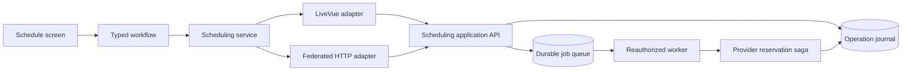

# Contact scheduling reference architecture

Contact scheduling is the first migrated slice. The schedule screen uses one typed application
service through either the LiveVue page adapter or the federated host bridge. Contact records,
provider-change decisions, and other features retain their existing protocols.

## Ownership

| Owner                                                         | Responsibility                                                               |
| ------------------------------------------------------------- | ---------------------------------------------------------------------------- |
| `OpsContactSchedule.vue`                                      | Presentation, accessible controls, operation history                         |
| `contact-schedule-state.ts`                                   | Draft, search lifetime, read supersession, independent mutation observations |
| `schedule-transitions.ts`                                     | Pure, monotonic operation transitions                                        |
| `schedule-service.ts`                                         | Versioned wire decoding, pinned actor/scope/query, typed application API     |
| `schedule-page-adapter.ts`, remote `contact-schedule-port.ts` | Transport envelopes and departed authority                                   |
| `Cadence.Contacts.ScheduleOperations`                         | Authorization, immutable intents, durable acceptance, scoped observation     |
| `Cadence.Contacts.ScheduleCommands`                           | Reviewed provider commands shared by durable and legacy entry points         |
| `Cadence.Jobs`                                                | Execution independent of the browser and LiveView process                    |
| Existing provider booking/cancellation contexts               | Reviewed evidence, provider idempotency, durable reservation saga            |

## Invariants

- Search and refresh are independent reads. Superseding a read never discards a mutation outcome.
- A booking uses the reviewed route, window, and opaque opportunity token. Editing the draft or
  changing route evidence makes the prior opportunity review ineligible for submission.
- Cancellation retains the exact reservation evidence the operator reviewed. The backend checks
  that evidence again when the queued operation executes.
- A command has an operation ID before dispatch. The server binds that ID to its actor,
  organization, mission, action, and input. Reusing it with different input is rejected.
- Operation acceptance and job enqueue commit in one database transaction. Provider I/O occurs
  outside that transaction, in the durable job worker.
- The worker notification follows commit. The queue's safety poll recovers missed notifications.
- A database constraint permits one unresolved intent per reservation across actors and tabs.
  Independent reservations can proceed concurrently.
- Workers reload the user and membership and reauthorize before provider I/O. A disabled or
  unauthorized actor produces a recorded rejection.
- A transport timeout means acceptance is unknown. Observation is read-only with respect to the
  provider. Retrying acceptance reuses the original ID and input.
- Recorded operations have immutable identity and increasing revisions. Older observations cannot
  undo newer ones; equal revisions with different content and changed terminal outcomes are rejected.
- A read that does not contain an in-flight operation cannot erase it. Exact-ID observation also
  works when that operation is outside the current history page.
- Returning to the mission loads server-owned operation history. History is paged in groups of ten,
  scoped to the current actor, organization, and mission.
- Initial data, refresh replies, and nested LiveVue patches pass through the same admission logic.
  Drafts remain separate from admitted server snapshots.
- Federation derives mission and spacecraft authority from path captures. A query filter named
  `spacecraft_id` remains a filter and cannot change the authorized host scope.

The feature has no `page-snapshot`/`remote-query` branch, generic action dispatcher, global busy
lock, or client-owned booking receipt authority. Pinia and TanStack Query are unnecessary for this
slice: there is one scoped page projection and an existing durable job system. Introduce a query
cache when multiple consumers actually need shared query lifetime or deduplication.

## Recovery limits

The worker records that execution may have started before entering provider code. After a worker
crash, a repeated job only observes the sealed reservation identity; it never blindly repeats a
provider mutation. If the crash happened before any reservation row was created, the operation
remains unconfirmed and requires operational investigation. This deliberately preserves an unknown
outcome; it does not promise exactly-once external effects or automatic resolution of every failure.

Provider errors and unsettled reservations also remain unconfirmed until durable provider evidence
establishes an outcome. Refreshing may persist newly observed evidence in the operation journal,
but it does not contact the provider or retry booking/cancellation. The existing provider
reconciliation subsystem remains responsible for obtaining new provider evidence.

The client retains uncertain acceptance within the mounted workflow. Once acceptance reaches the
server, recovery is durable across page departure, reconnect, and reload. An entirely undelivered
request has no durable server intent; the operation list does not claim otherwise.

## Compatibility and rollout

Apply `20260928000000_create_contact_schedule_operations.exs` before serving the new backend.
The existing job runner must be enabled to process accepted commands. No new route or authentication
pipeline is introduced; LiveVue and federation retain their authenticated entry points and the
application API independently authorizes each operation.

The wire payload discriminator is `contract_version: 2`; the surrounding application/surface
contract remains version 1. New clients require the version 2 workflow projection and fail closed
against an older backend. Deploy the backend and migration before new frontend artifacts.
The backend continues accepting version 1 action inputs for previously deployed remotes. Their
socket-owned workflow behavior is not upgraded by this compatibility support. Remove that path only
after the supported remote-release window closes.

## Enforcement and verification

Strict TypeScript checks the service, command and outcome unions. Runtime readers validate scope,
actor, query, operation identity, revisions, result identity, and completed lifecycle states.
The `scheduling-domain-api-only` structural rule prevents direct transport dispatch and protocol
selection in the migrated workflow and component, including embedded Vue scripts.

Behavioral coverage includes independent reads during mutations, duplicate clicks, immutable
acceptance retry, stale/equal/terminal operation revisions, draft edits during review, nested prop
patches, departed responses, and actor mismatch. Native producer/consumer tests exercise actual Vue
command construction and Phoenix output. Backend tests cover socket death, durable job execution,
reauthorization, scope isolation, conflicting intents, lost acceptance, provider reconciliation,
and the shared LiveVue/federated operation identity.
The production browser gate also books through LiveVue, leaves the page, recovers the same operation
through federation, cancels there, and verifies the completed cancellation back in LiveVue.

This slice does not resolve the separate host navigation transaction problem or migrate the other
features identified in the [architecture audit](architecture-audit-2026-09-27.md). It provides the
reference service, adapters, state transitions, durable protocol, and enforcement for that work.
